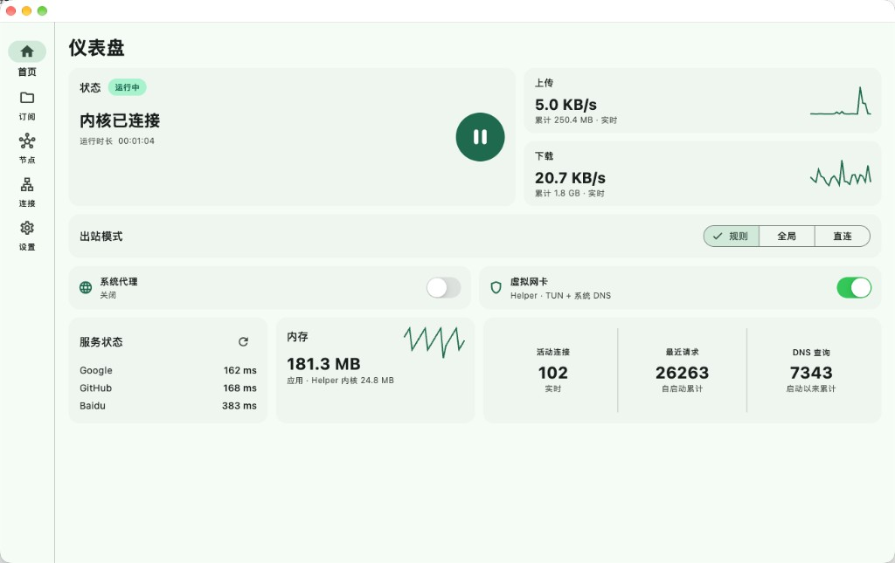
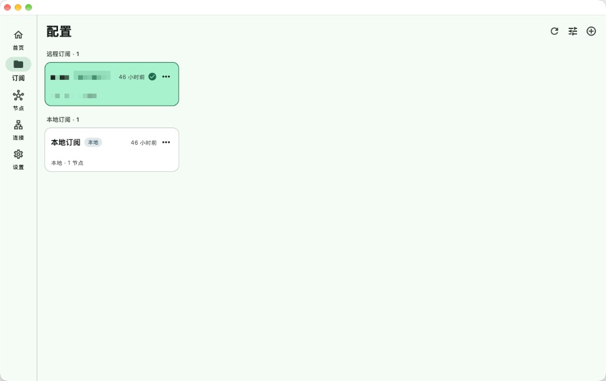
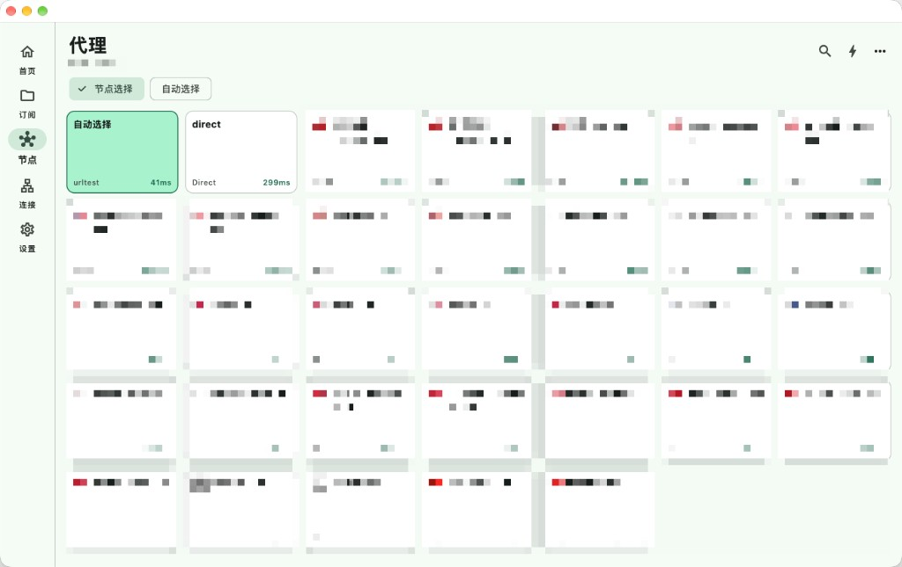
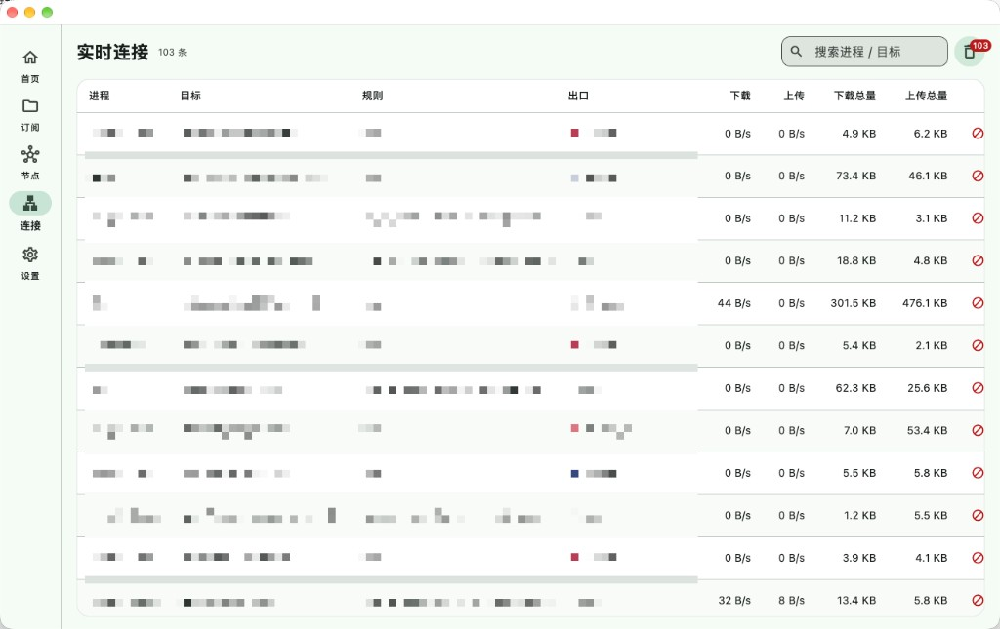
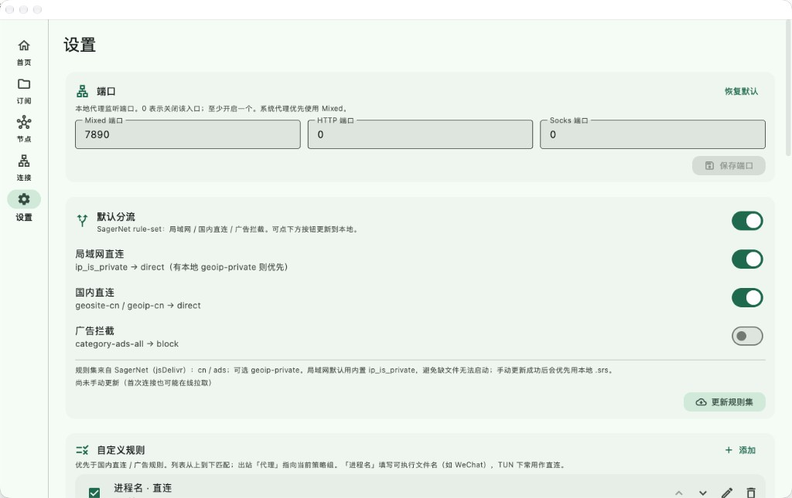
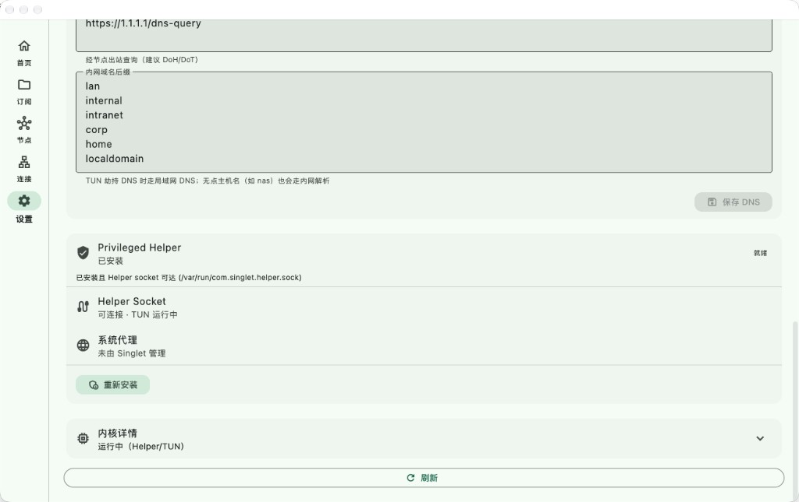

# Singlet

个人用 **macOS** Flutter 客户端：嵌入式 **sing-box**（Go c-shared）+ Material 3 + Clash YAML / Clash API。

## 截图

| 首页 | 订阅 |
|:---:|:---:|
|  |  |

| 节点 | 连接 |
|:---:|:---:|
|  |  |

| 设置 · 端口 / 分流 | 设置 · DNS / Helper |
|:---:|:---:|
|  |  |

> 订阅名、节点名、连接目标等敏感信息已打码。

## 架构

```
Flutter (Material 3)
  ├─ MethodChannel com.singlet/singbox_core
  │     → Swift SingBoxCoreLoader (dlopen)
  │     → Contents/Frameworks/libsingboxcore.dylib (Go + sing-box)
  ├─ MethodChannel com.singlet/helper        → Privileged Helper（TUN）
  └─ HTTP Clash API                      → 节点列表 / 切换 / delay
```

内核 C ABI：`SingletStart` / `SingletStop` / …。

## 前置

```bash
export PATH="$HOME/sdk/flutter/bin:/opt/homebrew/bin:$PATH"
# 若 flutter doctor 报 Xcode 问题：
sudo xcode-select -s /Applications/Xcode.app/Contents/Developer
```

- Go 1.23+（`GOPROXY=https://goproxy.cn,direct` 可按需）
- 完整 Xcode

## 构建 / 运行

```bash
cd /Users/liang/Workspace/Singlet

# 1) 编 Go c-shared（含 with_clash_api 等 tags）
make -C native/singboxcore

# 2) 跑 App（Xcode Run Script 会把 dylib 拷进 .app/Contents/Frameworks）
flutter pub get
flutter run -d macos
```

手动把 dylib 拷进已有 `.app`：

```bash
./scripts/copy_singboxcore_dylib.sh build/macos/Build/Products/Debug/Singlet.app
```

### 打包 DMG（Release）

```bash
./scripts/build_dmg.sh
# → dist/Singlet-<version>+<build>-macos-arm64.dmg
```

产物为 ad-hoc 签名，适合本机自用；首次打开需右键「打开」。

## 当前状态

| 能力 | 状态 |
|------|------|
| Swift `dlopen` + MethodChannel → C ABI | ✅ |
| dylib 打进 `.app`（Run Script） | ✅ |
| Go 依赖 sing-box，真实 Start/Stop | ✅ |
| Clash API（需 `-tags with_clash_api`） | ✅ 内核侧 |
| Flutter Clash API 节点页 HTTP | ✅（需内核已起） |
| Clash YAML 拉取 → sing-box 草稿 | ✅ 部分协议 |
| Privileged Helper 一键安装（osascript） | ✅ |
| 启动自动连接内核 | ✅ |
| TUN + 系统 DNS 劫持 | ✅ |
| 完整 Clash→sing-box 协议映射 | ❌ 部分（ss/socks/http） |

## License

**GPL-3.0-or-later** — see [`LICENSE`](./LICENSE).

本项目嵌入 / 链接 [sing-box](https://github.com/SagerNet/sing-box)（GPL-3.0-or-later，且其作者另有命名限制）。Singlet 为独立项目，与 sing-box / SagerNet **无隶属或背书关系**。
